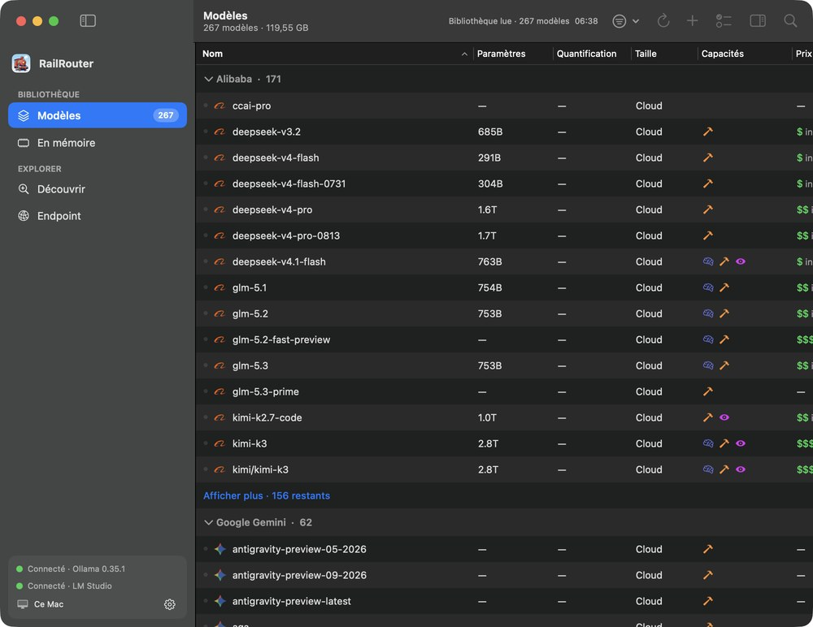

# RailRouter 🚂

**L'aiguillage local de tes LLM sur macOS.** Une app native pour voir tous les modèles
du Mac (Ollama, LM Studio, MLX) et un endpoint compatible OpenAI qui envoie chaque
requête au bon moteur.

[English](README.md) · [Page du projet](https://hugo291.github.io/RailRouter/)



## Fonctions

- **Bibliothèque** — tous les modèles Ollama et LM Studio dans un tableau : source,
  paramètres, quantification, taille, capacités. Regroupement, tri, recherche, copie de l'id en un clic.
- **En mémoire** — ce qui est chargé maintenant (MLX direct compris), RAM, état d'activité
  et, quand le moteur le donne, progression du prompt.
- **Découvrir** — catalogues Ollama, Hugging Face (GGUF/MLX) et LM Studio, filtre par
  capacité, tri par popularité, nouveauté ou nom, téléchargement.
- **Endpoint** — un service en arrière-plan sur `http://127.0.0.1:41235/v1`, API OpenAI,
  routage selon le champ `model` : Ollama, LM Studio, serveur MLX, modèles cloud Ollama,
  modèles gratuits OpenRouter (`:free`).

L'endpoint n'écoute que sur la boucle locale et continue après fermeture de la fenêtre
(LaunchAgent utilisateur `local.RailRouter.gateway`).

## Prérequis

macOS 14+, toolchain Swift 5.9+, et au moins un moteur : Ollama, LM Studio ou un serveur MLX.

## Installation rapide

```sh
curl -fsSL https://raw.githubusercontent.com/Hugo291/RailRouter/main/install.sh | bash
```

Clone le dépôt dans un dossier temporaire, compile, copie l'app dans `/Applications` et l'ouvre.
Nécessite la toolchain Swift (`xcode-select --install`).

## Construire et installer

```sh
make test
make install
open /Applications/RailRouter.app
```

## Limites

- Les compteurs viennent de vraies réponses, jamais d'une estimation.
- Seul LM Studio expose un pourcentage précis de traitement du prompt.
- Les appels qui contournent l'endpoint ne sont pas suivis.
- Le journal de télémétrie ne garde que ids, phases, dates et compteurs.

## Licence

[MIT](LICENSE)
